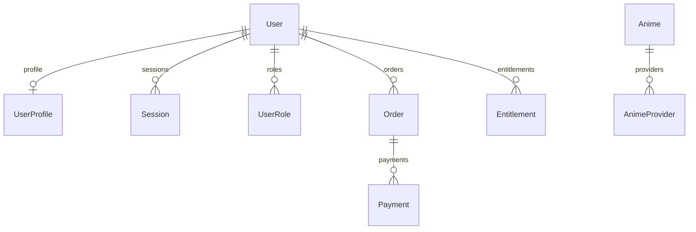

[English](DATA_MODEL.md) | [Русский](DATA_MODEL.ru.md)

# Data and public contracts

Authoritative schema: [schema.prisma](../../packages/database/prisma/schema.prisma).
Initial migration: [202610060001_foundation](../../packages/database/prisma/migrations/202610060001_foundation/migration.sql).
A table does not imply an implemented workflow. Local PostgreSQL migration and restoration remain
unconfirmed; see [migration evidence](../migration/STATUS.md).

## Schema relationships

| Model             | Main fields/constraints                                                                                       | Current use                                                                       |
| ----------------- | ------------------------------------------------------------------------------------------------------------- | --------------------------------------------------------------------------------- |
| `User`            | UUID, unique email, nullable `passwordHash`, creation/blocking                                                | Public profile reads check `disabledAt`; registration/import are pending          |
| `UserProfile`     | One profile per UUID, unique `usernameKey`, visibility/indexing consent, media, badge, presence and JSON      | Public profile read API                                                           |
| `Session`         | User, unique token hash, expiry/revocation and `mfaVerifiedAt`                                                | Schema only; no session issuance/verification                                     |
| `UserRole`        | Unique `(userId, role)`                                                                                       | Schema only; no role assignment or owner bootstrap                                |
| `Anime`           | UUID, unique slug, names, aliases, description, genres, year, poster, status, publication and `isDevelopment` | Catalog, detail and sitemap reads                                                 |
| `AnimeProvider`   | `(provider, externalId)` primary key; unique `(animeId, provider)`                                            | Mapping schema only; no provider calls                                            |
| `ProviderSetting` | Key and persistent `enabled`, default false                                                                   | Schema only; no admin toggle                                                      |
| `AuditEvent`      | Action, nullable actor UUID, object, reason, timestamp                                                        | Schema only; `actorId` has no foreign key and append-only permissions are pending |
| `Order`           | User, `amountMinor`, three-character currency, product and status                                             | Payment boundary only; no order creation                                          |
| `Payment`         | Order, provider/external ID, unique `(provider, externalId)`                                                  | Schema only; no charging/refunds                                                  |
| `WebhookEvent`    | Provider/external ID, payload hash, receipt/processing timestamps; unique pair                                | Schema only; no callback endpoint/signature validation                            |
| `Entitlement`     | User, permission, source, expiry/revocation                                                                   | Schema only; no premium issuance/enforcement                                      |

Profile, sessions, roles and entitlements use Cascade on their user relationship.
Orders/payments use Restrict on their relationships, preserving financial records from those cascades.
`WebhookEvent`, `ProviderSetting` and `AuditEvent` have no additional Prisma relations.
Order statuses are `pending`, `paid`, `failed`, `refunded`; subscription, plan, price and refund
models have not been added yet.

## Profile privacy and presence

`UserProfile.content` temporarily stores JSON `favoriteIds`, `folders`, `ratings`, `statistics`.
Library, folders, ratings and progress are not yet normalized into separate tables.
`visibility` contains five booleans: `about`, `favorites`, `folders`, `ratings`, `statistics`.
Visibility is server-internal and excluded from the public DTO.

| Stored value                          | Public output                                                   |
| ------------------------------------- | --------------------------------------------------------------- |
| `userId`                              | `id`, the same UUID rather than a username or sequential number |
| `username` / `usernameKey`            | Display `username`; comparison key stays in the database        |
| `avatar`, `banner`, `badge`           | Public nullable strings; badge does not grant roles/premium     |
| `online`, `offline`, `dnd`            | Corresponding public presence                                   |
| `invisible`                           | `offline`                                                       |
| Hidden block                          | Field is removed, not sent with a hidden flag                   |
| Email, password hash, sessions, roles | Absent from the public profile                                  |

Reads require `isPublic=true` and `User.disabledAt=null`. `indexable` is separate search-indexing
consent, not a consequence of public visibility. Statistics currently come from JSON: `watched`
counts anime, `minutes` holds minutes; the page displays `Math.round(minutes / 60)` hours.
No viewing-event aggregation is implemented yet.

## API contracts

| Source                                                    | Contents                                                     | Consumers                                         |
| --------------------------------------------------------- | ------------------------------------------------------------ | ------------------------------------------------- |
| [catalog.ts](../../packages/contracts/src/catalog.ts)     | `animeSchema`, `catalogSchema`, `searchSchema`               | Catalog API and Next.js server client             |
| [profiles.ts](../../packages/contracts/src/profiles.ts)   | `visibilitySchema`, `publicProfileSchema`, `publicProfile()` | API serializer, Next.js and privacy tests         |
| [providers.ts](../../packages/contracts/src/providers.ts) | Pure `providerDecision()` function                           | Policy tests; no runtime provider integration yet |

Zod validates input and output at runtime. Catalog output is `{ source, items }`, where source is
`development` or `database`. See [API endpoints](SITE_MAP.md#public-api).
Provider policy prioritizes the environment restriction over the stored toggle, then checks credentials.
It is not yet wired to an adapter or `ProviderSetting`.

## Sources and import

`DEMO_CATALOG=true` reads [fixtures.ts](../../packages/database/src/fixtures.ts) in memory:
four anime and the `soul` profile. This is neither a migrated account nor authentication.
The local [seed.ts](../../packages/database/src/seed.ts) inserts only development anime into PostgreSQL,
marks them `isDevelopment=true`, and creates no user/profile/administrator.
Switching off demo after seeding will not create a database `soul` profile.

`DEMO_CATALOG=false` uses [createDatabase()](../../packages/database/src/index.ts), Prisma and PostgreSQL.
Legacy JSON/SQLite remains in `AnimeSoulArchive/app/data` and the protected backup; the API does not
read or import it automatically. Connecting PostgreSQL does not migrate that data.

Next work: repeatable import preserving UUIDs and anime mappings, normalized library/folders/ratings/progress,
unresolved-link reports, password migration and old-session revocation. Identity stays separate from username;
permissions stay separate from decorative badges. Run migrations only against the explicitly selected database;
see [local development](../operations/LOCAL_DEVELOPMENT.md).
