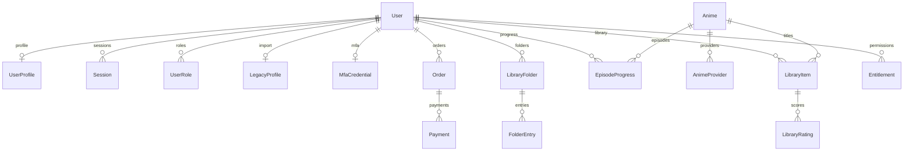

[English](DATA_MODEL.md) | [Русский](DATA_MODEL.ru.md)

# Данные и публичные контракты

Актуальная [схема Prisma](../../packages/database/prisma/schema.prisma) применяется через двенадцать SQL-миграций.
Проверки PostgreSQL, переноса и восстановления описаны в [статусе](../migration/STATUS.ru.md).

| Таблица                                                      | Действующее назначение                                                                                                         |
| ------------------------------------------------------------ | ------------------------------------------------------------------------------------------------------------------------------ |
| User                                                         | UUID, уникальная nullable почта, nullable Argon2id hash, блокировка. У непривязанных импортированных профилей нет почты/пароля |
| UserProfile                                                  | Имя и ключ, приватность, описание, медиа/декоративный badge, присутствие, visibility и приватные preferences                   |
| Session                                                      | Хеш случайного токена, audience web/admin, срок, отзыв, подтверждение MFA                                                      |
| UserRole                                                     | Уникальная пара user/role; owner назначается явной операторской командой                                                       |
| LegacyProfile                                                | Исходный ID → UUID, hash исходного профиля, одноразовый claim hash/срок и отметка привязки                                     |
| MfaCredential                                                | Зашифрованный TOTP, ограниченный по времени pending secret, последний counter и хеши резервных кодов                           |
| AuthThrottle                                                 | Хешированный ключ лимита, число попыток и начало окна; хранится между перезапусками                                            |
| LibraryItem                                                  | Уникальная пара user/anime, любимое, общая оценка, последняя серия/озвучка/сезон, безопасные детали и трекинг                  |
| LibraryRating                                                | Нормализованные оценки сезонов/серий, уникальный user/anime/scope/key, FK на библиотеку владельца                              |
| LibraryFolder / FolderEntry                                  | Папки владельца, принадлежность аниме и приватная заметка. Составной FK folder/user запрещает чужое владение                   |
| EpisodeProgress                                              | Уникальный user/anime/episode key, позиция/длительность в секундах, watchedSeconds, completed, безопасные детали               |
| Anime / AnimeProvider                                        | Стабильный внутренний UUID/slug и метаданные; точные соответствия внешним ID                                                   |
| Character / AnimeCharacter                                   | Устойчивый ID Shikimori, имена/портрет/описание персонажа и роли в конкретных тайтлах                                          |
| ProviderSetting                                              | Сохранённый выключатель источника, false по умолчанию; окружение может запретить источник выше этой настройки                  |
| AuditEvent                                                   | Импорт, привязка, вход/выход, пароль, MFA, приватность и операторские действия. Права append-only БД ещё впереди               |
| SubscriptionTrial / SubscriptionPlan / SubscriptionPromotion | Однократный пробный период, тарифы и акции с датами; см. [подписки](../operations/SUBSCRIPTIONS.ru.md)                         |
| Entitlement                                                  | Доступ к плееру на срок, включая ручную выдачу и отзыв с аудитом; проверяется перед выдачей видеофайла                         |
| Order / Payment / WebhookEvent                               | Граница будущих платежей; обработка оплаты пока не подключена                                                                  |

User удаляет свой профиль, сессии и библиотеку каскадом. Anime нельзя удалить, пока на него ссылается библиотека.
Финансовые отношения используют Restrict. AuditEvent не имеет FK на актёра.

## Приватность

Миграция `20261007220000_catalog_discovery` добавляет оценки/голоса Shikimori, популярность,
формат, озвучки, размер известной франшизы и проверенные публичные сведения в Anime.
Премьеры, студии, длительность, число серий, трейлеры/кадры и связанные ID не содержат
ключей или временных видеоадресов. Оценка сообщества агрегирует LibraryItem;
персональные жанры выводятся из сохранённых просмотров.

Новые любимое, папки, оценки и прогресс читаются из отдельных таблиц. `UserProfile.content` остаётся
для старой основы, но не используется для новых записей библиотеки. `preferences` приватен.
`visibility` содержит about/favorites/folders/ratings/statistics. Публичный DTO не выдаёт сами флаги,
почту, preferences, notes, сессии, MFA, роли или hashes. Закрытые блоки удаляются до API/HTML/metadata.
`invisible` выдаётся как `offline`. В гостевой выдаче профиль доступен только при isPublic и активном пользователе;
индексация дополнительно требует отдельного согласия. watched считает тайтлы с завершёнными сериями,
minutes — сохранённые watchedSeconds; новый плеер передаёт временные позиции автоматически при наличии событий источника.

## Импорт и временные ссылки

Четыре локальных профиля перенесены без вымышленных credentials и привилегий. Три UUID сохранены,
один legacy ID сопоставлен детерминированно. Повторный импорт не перезаписывает новые изменения;
изменённый исходник требует проверенного слияния. Неизвестные тайтлы остаются неопубликованными
записями с точными provider ID и заполняются следующим импортом каталога.
В БД нет поля для видео URL. Импорт не копирует video/iframe/credential URL из старых настроек.
Актуальные iframe получаются при запросе просмотра; ответы провайдера кешируются в RAM на 60 секунд.
Подписанные HLS/MP4 URL новым runtime не сохраняются.

Контракты: [account.ts](../../packages/contracts/src/account.ts), [profiles.ts](../../packages/contracts/src/profiles.ts),
[catalog.ts](../../packages/contracts/src/catalog.ts), [playback.ts](../../packages/contracts/src/playback.ts).
[Аккаунты](../operations/ACCOUNTS.ru.md) · [Маршруты](SITE_MAP.ru.md) · [Просмотр](../operations/PLAYBACK.ru.md).

## Каталог и очередь этапа 3

Anime.searchText автоматически собирается из названий и aliases триггером БД.
Anime.metadataProvider отличает Kodik от ручных и сохранённых legacy-записей.
KodikRelease связывает несколько озвучек с UUID без видео URL. CatalogImportPage хранит хеши курсоров для обнаружения циклов.
CatalogImportJob хранит провайдера, стратегию Kodik, число выпусков API, непрозрачный курсор, аренду, счётчики и локальные коды ошибок.
Частичный уникальный индекс разрешает одно queued/running/paused задание провайдера.
ProviderMappingConflict сохраняет кандидатов, снимок соответствия, версию и решение;
ProviderMappingOverride удерживает решение при следующем импорте. Внешние ID можно
переназначить без объединения Anime или изменения ссылок LibraryItem/FolderEntry/EpisodeProgress.
Job и AuditEvent не содержат ключей, ответов провайдера или видео URL.
[Операции каталога](../operations/CATALOG.ru.md).

## Идентичность аккаунта

Миграция `20261007093000_account_identity` добавляет `User.emailVerifiedAt`, уникальный nullable `googleSubject` и `authVersion`. Существующие UUID/данные сохраняются; старые email не получают подтверждение автоматически. `AccountToken` хранит один токен на user/purpose (verify/reset/change), SHA256, targetEmail, issuedVersion, срок и consumedAt. `OAuthAttempt` хранит хеши state/browser, nonce, зашифрованный PKCE verifier, optional user/session binding, срок и потребление. Access/refresh tokens Google не сохраняются.

Модели контента, голосов, сообщений и комнат — будущие модели; дружба добавлена на этапе 5; они не входят в эту миграцию: [План соцсети](SOCIAL_NETWORK_PLAN.ru.md).

## Серии и прогресс этапа 4

`Episode` содержит стабильный UUID, animeId, нормализованные season/number и необязательную длительность.
Уникальность animeId/season/number не зависит от озвучки. `EpisodeProvider` связывает provider/animeId/externalId
с UUID серии; externalId — идентификатор нормализованного источника, не URL. Composite FK не позволяет связать
серии разных тайтлов. Существующие соответствия не перезаписываются при конфликте.
`EpisodeProgress.episodeId` nullable: старые записи остаются без переписывания ключей/позиций.
Новые ключи `episode:<UUID>` имеют ссылку на серию; `activePlaybackId` определяет последнюю вкладку.
`PlaybackSession` привязана к пользователю, web Session и Episode, содержит sequence/lastEventAt/expiresAt,
но не credentials и не URL. Последовательность проверяется под row lock, watchedSeconds ограничены wall time.
Сессии каскадно удаляются при удалении auth Session; собственные просроченные очищаются при новом запуске.
[Контракты серий](../../packages/contracts/src/episodes.ts) · [Потоки](../../packages/contracts/src/streams.ts) · [Эксплуатация](../operations/PLAYBACK.ru.md).

## Отношения этапа 5

FriendRequest и Friendship имеют составной ключ lowId/highId и CHECK порядка UUID; requestedBy должен быть одним из участников. Follow и UserBlock имеют направленные ключи и запрет связи с собой. FK на User удаляются каскадом. UserProfile.profileAccess/friendRequests расширяют настройки, прежний isPublic остаётся границей гостевой выдачи. visibility поддерживает public/friends/private для прежних и будущих разделов; boolean-флаги читаются совместимо. [Поведение и миграция](../operations/FRIENDS.ru.md).

## Публикации для локального сообщества

Миграция `20261007200000_content` добавляет Post и Comment. Рецензия — Post.kind=review,
один активный вариант на автора/тайтл ограничен частичным уникальным индексом. Post хранит
аудиторию, хештеги, метки, UUID аниме/серии и таймкод; Comment имеет ровно один объект
(animeId, episodeId или postId) и необязательный родитель. Удаление комментария оставляет
заглушку. Индексы поддерживают историю автора и обсуждение объекта. Изменение пары с блокировкой
проверяется в транзакции. Adult-предпочтение сохраняется отдельно в preferences.
[Поведение](../operations/CONTENT.ru.md) · [Демо-данные](../operations/DEMO_COMMUNITY.ru.md).

## Данные администрирования

`AnalyticsEvent`, `Announcement`, `NotificationCampaign`, `NotificationReceipt`, `SiteSetting`;
существующие User/AuditEvent/SubscriptionPlan/SubscriptionPromotion/Entitlement расширены добавочными полями и индексами.

[Миграции, сбор событий и границы хранения](../operations/ADMINISTRATION.ru.md).
