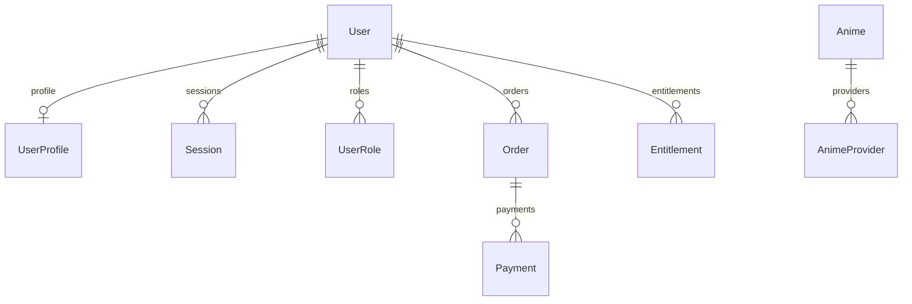

[English](DATA_MODEL.md) | [Русский](DATA_MODEL.ru.md)

# Данные и публичные контракты

Актуальная схема: [schema.prisma](../../packages/database/prisma/schema.prisma).
Первая миграция: [202610060001_foundation](../../packages/database/prisma/migrations/202610060001_foundation/migration.sql).
Наличие таблицы не означает, что её сценарий уже реализован. Применение миграции и восстановление
локального PostgreSQL пока не подтверждены; [статус миграции](../migration/STATUS.ru.md) фиксирует проверки.

## Связи в схеме

| Модель            | Основные данные и ограничения                                                                                           | Реальное использование сейчас                                                  |
| ----------------- | ----------------------------------------------------------------------------------------------------------------------- | ------------------------------------------------------------------------------ |
| `User`            | UUID, уникальный email, nullable `passwordHash`, создание и блокировка                                                  | Публичное чтение проверяет `disabledAt`; регистрации/импорта пока нет          |
| `UserProfile`     | Один профиль на UUID, уникальный `usernameKey`, публичность, согласие на индексацию, медиа, `badge`, присутствие и JSON | API читает разрешённый публичный профиль                                       |
| `Session`         | Пользователь, уникальный хеш токена, срок, отзыв и `mfaVerifiedAt`                                                      | Только схема; сессии не выдаются и не проверяются                              |
| `UserRole`        | Пара `(userId, role)` уникальна                                                                                         | Только схема; назначения ролей и bootstrap владельца нет                       |
| `Anime`           | UUID, уникальный slug, названия, aliases, описание, жанры, год, постер, статус, публикация и `isDevelopment`            | Чтение каталога, страницы и sitemap                                            |
| `AnimeProvider`   | Ключ `(provider, externalId)` и уникальность `(animeId, provider)`                                                      | Только схема сопоставлений; адаптеры не вызываются                             |
| `ProviderSetting` | Ключ и сохраняемый `enabled`, по умолчанию false                                                                        | Только схема; admin-переключателя ещё нет                                      |
| `AuditEvent`      | Действие, nullable UUID актёра, объект, причина, время                                                                  | Только схема; `actorId` сейчас без foreign key, append-only права не настроены |
| `Order`           | Пользователь, сумма `amountMinor`, валюта из 3 символов, продукт и статус                                               | Основа платежей; создание заказа не реализовано                                |
| `Payment`         | Заказ, провайдер и внешний ID, уникальная пара `(provider, externalId)`                                                 | Только схема; списаний/возвратов нет                                           |
| `WebhookEvent`    | Провайдер, внешний ID, хеш payload, время получения/обработки; уникальная пара                                          | Только схема; endpoint и проверка подписи отсутствуют                          |
| `Entitlement`     | Пользователь, permission, источник, срок и отзыв                                                                        | Только схема; премиум-права ещё не выдаются и не проверяются                   |

Профиль, сессии, роли и права удаляются вместе с пользователем по Cascade.
Заказы и платежи имеют Restrict на своих связях: финансовые записи не удаляются таким каскадом.
`WebhookEvent`, `ProviderSetting` и `AuditEvent` не имеют дополнительных отношений Prisma.
Статусы заказа: `pending`, `paid`, `failed`, `refunded`; подписки, тарифы, цены и возвраты
отдельными моделями ещё не выделены.

## Профиль, приватность и присутствие

`UserProfile.content` — временный JSON для `favoriteIds`, `folders`, `ratings` и `statistics`.
Библиотека, папки, оценки и прогресс пока не нормализованы в отдельные таблицы.
`visibility` содержит пять boolean: `about`, `favorites`, `folders`, `ratings`, `statistics`.
Эти поля доступны серверу; публичный DTO их не выдаёт.

| Хранение                              | Публичный ответ                                                    |
| ------------------------------------- | ------------------------------------------------------------------ |
| `userId`                              | `id` — тот же UUID, а не порядковый номер или ник                  |
| `username` / `usernameKey`            | Отображаемый `username`; ключ сравнения остаётся в БД              |
| `avatar`, `banner`, `badge`           | Публичные строки/nullable значения; badge не даёт роль или премиум |
| `online`, `offline`, `dnd`            | Выдаётся соответствующее присутствие                               |
| `invisible`                           | Выдаётся `offline`                                                 |
| Скрытый блок                          | Поле отсутствует в ответе, а не приходит с флагом «скрыто»         |
| `email`, `passwordHash`, сессии, роли | Не входят в публичный профиль                                      |

Публичная запись читается только при `isPublic=true` и `User.disabledAt=null`.
`indexable` — отдельное согласие на поисковую индексацию; публичность сама по себе его не включает.
Статистика сейчас берётся из JSON: `watched` — число аниме, `minutes` — минуты;
страница показывает `Math.round(minutes / 60)` часов. Это ещё не расчёт по событиям просмотра.

## Контракты API

| Файл                                                      | Содержимое                                                   | Потребители                                             |
| --------------------------------------------------------- | ------------------------------------------------------------ | ------------------------------------------------------- |
| [catalog.ts](../../packages/contracts/src/catalog.ts)     | `animeSchema`, `catalogSchema`, `searchSchema`               | API каталога и серверный клиент Next.js                 |
| [profiles.ts](../../packages/contracts/src/profiles.ts)   | `visibilitySchema`, `publicProfileSchema`, `publicProfile()` | Серверный сериализатор API, Next.js и тесты приватности |
| [providers.ts](../../packages/contracts/src/providers.ts) | Чистая функция `providerDecision()`                          | Сейчас тесты политики; реальной интеграции ещё нет      |

Ввод и ответы проверяются во время выполнения через Zod. Каталог отвечает `{ source, items }`,
где `source` — `development` или `database`. API-поля перечислены в [карте API](SITE_MAP.ru.md#публичный-api).
Политика провайдеров ставит запрет окружения выше настройки администратора, затем проверяет наличие ключей.
Она пока не подключена к адаптеру или `ProviderSetting`.

## Источники и перенос

`DEMO_CATALOG=true` читает [fixtures.ts](../../packages/database/src/fixtures.ts) в памяти:
четыре аниме и один профиль `soul`. Это не импорт старого аккаунта и не авторизация.
Локальный [seed.ts](../../packages/database/src/seed.ts) записывает только demo-аниме в PostgreSQL,
помечает их `isDevelopment=true` и не создаёт пользователя, профиль или администратора.
При выключении demo после seed профиль `soul` сам по себе в БД не появится.

`DEMO_CATALOG=false` использует [createDatabase()](../../packages/database/src/index.ts),
Prisma и PostgreSQL. Данные прежнего сайта остаются отдельно в `AnimeSoulArchive/app/data`
и защищённой копии; старые SQLite/JSON не читаются новым API автоматически.
Подключение PostgreSQL не переносит эти данные.

Следующий этап: повторяемый импорт с сохранением UUID и сопоставлений аниме, нормализация
библиотеки/папок/оценок/прогресса, отчёт пропущенных связей, политика паролей и отзыв прежних сессий.
Идентичность пользователя отделена от ника, права — от декоративного badge.
Миграции запускаются только против явно выбранной БД; инструкция — в [локальной разработке](../operations/LOCAL_DEVELOPMENT.ru.md).
