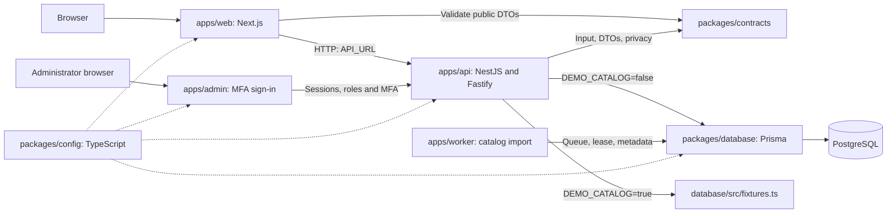

[English](PROJECT_MAP.md) | [Русский](PROJECT_MAP.ru.md)

# Project map

Checked against `main` on 2026-10-07. This describes implemented source; future modules belong to
the [roadmap](WEB_STACK_PLAN.md). See the [site/API map](SITE_MAP.md) and [data model](DATA_MODEL.md).

## Workspaces and Git

| Directory or ref                                                                                      | Contents                                                                              | Purpose                                                                      |
| ----------------------------------------------------------------------------------------------------- | ------------------------------------------------------------------------------------- | ---------------------------------------------------------------------------- |
| `C:/Users/dogem/Documents/AnimeSoul`, `main`                                                          | New TypeScript website                                                                | Primary development and local launch                                         |
| `C:/Users/dogem/Documents/AnimeSoulArchive`, `codex/legacy-local-2026-10-06`                          | Previous local workspace on the old `master`, including private data and dependencies | Local-state recovery; excluded from website builds                           |
| `codex/archive-current-2026-10-06`, tag `archive-current-2026-10-06`, commit `cd54517`                | Committed snapshot of the previous implementation                                     | Source history and comparison; contains no secrets                           |
| `C:/Users/dogem/Documents/AnimeSoulMobile`, its own `main`                                            | Independent Android repository                                                        | Separate builds, documentation and history; not connected to the new API yet |
| `C:/Users/dogem/.codex/worktrees/new-web-stack/AnimeSoul`, `codex/root-workspace-transfer-2026-10-06` | Additional new-stack checkout                                                         | No longer occupies `main`; primary launch moved to `Documents/AnimeSoul`     |

These paths describe this machine. A new checkout needs only its own root, Node.js and pnpm;
adjacent workspaces are not build dependencies. The GitHub default branch is `main`; production deployment is separate.
The protected data backup is at `AnimeSoulArchive/artifacts/migration-backup/2026-10-06`;
see [migration/recovery status](../migration/STATUS.md).

## Source tree

```text
AnimeSoul/
  apps/
    web/
      app/                   Next.js pages, layout, errors, robots and sitemap
      components/            Site/profile headers, cards, icons and footer
      lib/                   Server HTTP client and SEO rules
      styles/                Page-specific CSS imported by app/globals.css
      public/                Logo and trusted profile SVG presets
    api/
      src/main.ts            API entry point
      src/app.ts             Nest module, Fastify and HTTP protections
      src/config.ts          Server environment validation
      src/catalog/           Catalog and public profiles: controller + service
      src/health/            Process liveness and PostgreSQL readiness
      src/admin/             Role and MFA-protected administration boundary
      tests/                 API HTTP/configuration checks
    admin/app/               Separate Next.js; MFA sign-in screen
    worker/                  main.mjs: catalog imports, PostgreSQL queue, leases and cursor
  packages/
    contracts/src/           Zod schemas, privacy serializer and provider policy
    contracts/tests/         Privacy and provider environment restrictions
    database/prisma/         Database schema and versioned SQL migrations
    database/src/            PostgreSQL client, fixtures and development seed
    config/                  Shared TypeScript, ESLint and Prettier configuration
  docs/                      Maps, architecture, operations, security and migration
  compose.yaml               Full Docker stack: PostgreSQL, migrations, API, worker, web and admin
  compose.ghcr.yaml           Pull application images from GHCR
  compose.server.yaml        Server: Caddy/HTTPS and private internal ports
  infra/docker/              Dockerfile, readiness checks and Caddyfile
  infra/compose.dev.yaml      Previous separate PostgreSQL/Redis infrastructure
  scripts/
    workspace/               Setup, build, dev and child pnpm commands
    quality/                 Documentation link checks
    docker/                  Copy native PostgreSQL into an empty Docker database
    windows/                 Docker launcher, .env setup and separate Dev launcher
  tests/                     SEO, compiled HTML and PostgreSQL integration
  .github/workflows/publish-containers.yml  Manual GHCR publication
  package.json               Workspace commands, Node.js and pinned pnpm
  pnpm-workspace.yaml         Workspace packages and installation policy
  pnpm-lock.yaml              Pinned dependency graph
  .env.example               Local configuration template without real secrets
  .vscode/settings.json       Shared ESLint config path for the editor
```

`node_modules`, `.next`, `dist`, Prisma `generated`, `artifacts` and the private `.env`
are local, ignored outputs. An empty old `app/deploy` directory may remain while Windows holds
it open; it contains no source and is unused. IDE settings are not application source either.
Prettier discovers configuration through `package.json`'s `prettier` field; its ignore file remains at the root.
Git, EditorConfig, Docker and pnpm use their conventional root files. See [scripts/README](../../scripts/README.md)
and [packages/config/README](../../packages/config/README.md).

## Dependencies

Playback additions: `apps/api/src/providers` owns adapters, cache and repeatable catalog import;
`apps/api/src/playback` owns manifests, stable episodes, bound progress sessions and private stream resolution.
Contracts `playback.ts`, `episodes.ts`, `streams.ts`, `player-events.ts` validate DTOs and iframe events.
`AnimePlayer.tsx` selects episodes/translations; `NativePlayer.tsx` plays HTML5/HLS;
`EmbeddedPlayer.tsx` validates iframe messages; `usePlaybackProgress.ts` reports account progress.
`PlayerMenus.tsx` provides shared menus; `styles/custom-player.css` retains the archived player appearance.
`styles/playback.css` styles the player, `app/anime/[slug]/episodes/[episodeId]` serves episode SSR,
and `app/episodes` serves sitemap shards. Next validates same-origin playback/stream responses
without trusting caller-supplied viewer IPs. Native cluster and restore commands are in
`local-database.mjs`/`verify-database.mjs`; private settings and local operator switches are in
`import-provider-settings.mjs`/`provider-switch.mjs`. [Operations](../operations/PLAYBACK.md).



Solid lines operate today; the worker queue is persisted in PostgreSQL;
`packages/config` links apply at compilation. Compose can start Redis, but the application does not
use it yet. The mobile client does not consume the new API.

`apps/web/lib/api.ts` executes only on the Next.js server. The browser cannot access PostgreSQL
or `DATABASE_URL`. Server pages request JSON from the API, validate it with `contracts` and render HTML.
Client components `SiteHeader` and `ProfileHeader` control the menu and scroll animation;
AccountPanel, LibraryPanel and AnimeLibraryActions submit same-origin mutations.

### Public profile request

1. Next.js opens `/users/:username` and requests `/api/profiles/:username`.
2. `CatalogController` bounds the name length; `CatalogService` reads a fixture or public database record.
3. `publicProfile()` removes hidden blocks, visibility settings and extra fields; `invisible` becomes `offline`.
4. `getProfile()` validates the public DTO. The page renders visible blocks and permitted metadata/JSON-LD.
5. `ProfileHeader` collapses identity into the site header. This animation does not persist profile settings.

Privacy applies before HTTP, HTML and metadata serialization. The public `badge` string is decoration;
it does not establish an administrative role or premium entitlement.

## Where to make a change

| Task                   | Main source                                                                                    | Related checks/documentation                                                                      |
| ---------------------- | ---------------------------------------------------------------------------------------------- | ------------------------------------------------------------------------------------------------- |
| Home                   | `apps/web/app/page.tsx`, `styles/home.css`                                                     | [Site map](SITE_MAP.md), `tests/website.test.mjs`                                                 |
| Catalog and filters    | `apps/web/app/catalog/page.tsx`, `styles/catalog.css`, `apps/api/src/catalog/`                 | `contracts/src/catalog.ts`; the page currently applies filters other than `q`                     |
| Anime page             | `apps/web/app/anime/[slug]/page.tsx`, `styles/anime.css`                                       | Catalog DTO, metadata, `tests/seo.test.mjs`                                                       |
| Profile/header         | `apps/web/app/users/[username]/page.tsx`, `components/ProfileHeader.tsx`, `styles/profile.css` | `contracts/src/profiles.ts`, privacy and HTML tests                                               |
| Shared navigation      | `components/SiteHeader.tsx`, `components/SiteFooter.tsx`, `styles/header.css`                  | Navigation map and implemented links                                                              |
| Public API             | `apps/api/src/catalog/`, `apps/web/lib/api.ts`, `packages/contracts/src/`                      | `apps/api/tests/api.test.mjs`; [API map](SITE_MAP.md#public-api)                                  |
| Schema and migrations  | `packages/database/prisma/`, `src/index.ts`                                                    | [Data model](DATA_MODEL.md), `tests/database.test.mjs`                                            |
| Administration         | `apps/admin/app/`, `apps/api/src/admin/`, protections in `src/app.ts`                          | Explicit role and separate MFA session required                                                   |
| Profile media          | `apps/web/public/profile-presets/`                                                             | [Asset guide](../../apps/web/public/ASSETS.md); presets, uploads and GIPHY work in /account       |
| Launch/infrastructure  | `scripts/`, `compose.yaml`, `compose.server.yaml`, `infra/docker/`, `.env.example`             | [Docker/server](../operations/DOCKER.md), [local development](../operations/LOCAL_DEVELOPMENT.md) |
| Publication and checks | `.github/workflows/publish-containers.yml`, `scripts/quality/`, `package.json`                 | Manual GHCR publication; local checks and secret scanning                                         |

The API currently has no `src/modules` directory, shared `ui` package, OpenAPI or generated mobile SDK.
These are roadmap targets. Route, DTO, model and command changes require corresponding map updates
in both languages and the relevant [verification commands](../operations/LOCAL_DEVELOPMENT.md).

## Accounts and libraries

`apps/api/src/auth` owns Argon2id, sessions, Origin/CSRF and MFA; `src/account` owns profile/library mutations.
`src/migration/import-profiles.ts` imports local profiles repeatably. Next implements `/account`, `/library`,
AccountPanel, LibraryPanel, AnimeLibraryActions and bounded same-origin proxies.
Operator scripts: migrate-profiles.mjs and account-operator.mjs. [Operations](../operations/ACCOUNTS.md).

The worker entry is `apps/worker/main.mjs`; typed implementation/control live in `apps/api/src/providers/catalog-jobs.ts` and `src/admin/catalog-admin.controller.ts`. [Catalog and queue](../operations/CATALOG.md).

## October 7 account extension

`auth/identity.controller.ts` exposes new HTTP routes; `account-email.service.ts` handles one-time confirmation/recovery; `account-mailer.ts` provides SMTP/local files. `google-auth.service.ts` persists attempts/linking; `google-client.ts` verifies Google ID tokens with jose. Nodemailer/jose belong only to the API. `AccountIdentity.tsx`, `account-client.ts`, allowlist proxy and separate Next callback serve the UI; SiteHeader reads /auth/me on account changes. `identity.ts` and `profile-media.ts` hold shared Zod schemas/trusted paths. `tests/identity.test.mjs` verifies HTTP and cryptographic boundaries. The social service and relationship tables exist; other social modules remain planned: [Social network plan](SOCIAL_NETWORK_PLAN.md).

## Stage 5 relationships

The social API in apps/api/src/social owns transactions/access; account/profile-reader.ts serializes permitted sections. The friends route, FriendsPanel, SocialActions and ProfileFriends provide UI; profile-viewer.ts reads with the web cookie. social.ts defines DTOs/visibility normalization; tests/social.test.mjs covers integration. [Behavior](../operations/FRIENDS.md).
