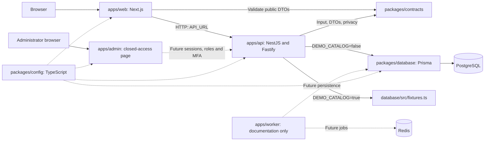

[English](PROJECT_MAP.md) | [Русский](PROJECT_MAP.ru.md)

# Project map

Checked against `main` on 2026-10-06. This describes implemented source; future modules belong to
the [roadmap](WEB_STACK_PLAN.md). See the [site/API map](SITE_MAP.md) and [data model](DATA_MODEL.md).

## Workspaces and Git

| Directory or ref                                                                                      | Contents                                                                              | Purpose                                                                      |
| ----------------------------------------------------------------------------------------------------- | ------------------------------------------------------------------------------------- | ---------------------------------------------------------------------------- |
| `C:/Users/dogem/Documents/AnimeSoul`, `main`                                                          | New TypeScript website                                                                | Primary development and local launch                                         |
| `C:/Users/dogem/Documents/AnimeSoulArchive`, `codex/legacy-local-2026-10-06`                          | Previous local workspace on the old `master`, including private data and dependencies | Local-state recovery; excluded from website builds                           |
| `codex/archive-current-2026-10-06`, tag `archive-current-2026-10-06`, commit `cd54517`                | Committed snapshot of the previous implementation                                     | Source history and comparison; contains no secrets                           |
| `C:/Users/dogem/Documents/AnimeSoulMobile`, its own `main`                                            | Independent Android repository                                                        | Separate builds, documentation and history; not connected to the new API yet |
| `C:/Users/dogem/.codex/worktrees/new-web-stack/AnimeSoul`, `codex/root-workspace-transfer-2026-10-06` | Additional new-stack checkout                                                         | No longer occupies `main`; primary launch moved to `Documents/AnimeSoul`     |

These paths describe this machine. A new checkout needs only its own root, Node.js and pnpm;
adjacent workspaces are not build dependencies. The remote default branch and production remain unchanged.
The protected data backup is at `AnimeSoulArchive/artifacts/migration-backup/2026-10-06`;
see [migration/recovery status](../migration/STATUS.md).

## Source tree

```text
AnimeSoul/
  apps/
    web/
      app/                   Next.js pages, layout, errors, robots and sitemap
      components/            Site/profile headers, cards, icons and footer
      lib/                   Server HTTP client and SEO rules
      styles/                Page-specific CSS imported by app/globals.css
      public/                Logo and trusted profile SVG presets
    api/
      src/main.ts            API entry point
      src/app.ts             Nest module, Fastify and HTTP protections
      src/config.ts          Server environment validation
      src/catalog/           Catalog and public profiles: controller + service
      src/health/            Process liveness and PostgreSQL readiness
      src/admin/             Closed administration boundary
      tests/                 API HTTP/configuration checks
    admin/app/               Separate Next.js; closed-access information page
    worker/                  Reserved worker documentation, no executable service
  packages/
    contracts/src/           Zod schemas, privacy serializer and provider policy
    contracts/tests/         Privacy and provider environment restrictions
    database/prisma/         Database schema and versioned SQL migrations
    database/src/            PostgreSQL client, fixtures and development seed
    config/                  Shared TypeScript, ESLint and Prettier configuration
  docs/                      Maps, architecture, operations, security and migration
  infra/compose.dev.yaml      Local PostgreSQL and Redis only
  scripts/
    workspace/               Setup, build, dev and child pnpm commands
    quality/                 Documentation link checks
    windows/                 Start AnimeSoul.bat
  tests/                     SEO, compiled HTML and PostgreSQL integration
  .github/workflows/quality.yml
  package.json               Workspace commands, Node.js and pinned pnpm
  pnpm-workspace.yaml         Workspace packages and installation policy
  pnpm-lock.yaml              Pinned dependency graph
  .env.example               Local configuration template without real secrets
  .vscode/settings.json       Shared ESLint config path for the editor
```

`node_modules`, `.next`, `dist`, Prisma `generated`, `artifacts` and the private `.env`
are local, ignored outputs. An empty old `app/deploy` directory may remain while Windows holds
it open; it contains no source and is unused. IDE settings are not application source either.
Prettier discovers configuration through `package.json`'s `prettier` field; its ignore file remains at the root.
Git, EditorConfig, Docker and pnpm use their conventional root files. See [scripts/README](../../scripts/README.md)
and [packages/config/README](../../packages/config/README.md).

## Dependencies



Solid lines operate today. Dashed admin/worker links represent planned integrations;
`packages/config` links apply at compilation. Compose can start Redis, but the application does not
use it yet. The mobile client does not consume the new API.

`apps/web/lib/api.ts` executes only on the Next.js server. The browser cannot access PostgreSQL
or `DATABASE_URL`. Server pages request JSON from the API, validate it with `contracts` and render HTML.
Client components `SiteHeader` and `ProfileHeader` control the menu and scroll animation;
they do not submit account mutations.

### Public profile request

1. Next.js opens `/users/:username` and requests `/api/profiles/:username`.
2. `CatalogController` bounds the name length; `CatalogService` reads a fixture or public database record.
3. `publicProfile()` removes hidden blocks, visibility settings and extra fields; `invisible` becomes `offline`.
4. `getProfile()` validates the public DTO. The page renders visible blocks and permitted metadata/JSON-LD.
5. `ProfileHeader` collapses identity into the site header. This animation does not persist profile settings.

Privacy applies before HTTP, HTML and metadata serialization. The public `badge` string is decoration;
it does not establish an administrative role or premium entitlement.

## Where to make a change

| Task                  | Main source                                                                                    | Related checks/documentation                                                  |
| --------------------- | ---------------------------------------------------------------------------------------------- | ----------------------------------------------------------------------------- |
| Home                  | `apps/web/app/page.tsx`, `styles/home.css`                                                     | [Site map](SITE_MAP.md), `tests/website.test.mjs`                             |
| Catalog and filters   | `apps/web/app/catalog/page.tsx`, `styles/catalog.css`, `apps/api/src/catalog/`                 | `contracts/src/catalog.ts`; the page currently applies filters other than `q` |
| Anime page            | `apps/web/app/anime/[slug]/page.tsx`, `styles/anime.css`                                       | Catalog DTO, metadata, `tests/seo.test.mjs`                                   |
| Profile/header        | `apps/web/app/users/[username]/page.tsx`, `components/ProfileHeader.tsx`, `styles/profile.css` | `contracts/src/profiles.ts`, privacy and HTML tests                           |
| Shared navigation     | `components/SiteHeader.tsx`, `components/SiteFooter.tsx`, `styles/header.css`                  | Navigation map and implemented links                                          |
| Public API            | `apps/api/src/catalog/`, `apps/web/lib/api.ts`, `packages/contracts/src/`                      | `apps/api/tests/api.test.mjs`; [API map](SITE_MAP.md#public-api)              |
| Schema and migrations | `packages/database/prisma/`, `src/index.ts`                                                    | [Data model](DATA_MODEL.md), `tests/database.test.mjs`                        |
| Administration        | `apps/admin/app/`, `apps/api/src/admin/`, protections in `src/app.ts`                          | Currently 401; sessions/MFA remain migration gates                            |
| Profile media         | `apps/web/public/profile-presets/`                                                             | [Asset guide](../../apps/web/public/ASSETS.md); picker/uploads are pending    |
| Launch/infrastructure | `scripts/`, `infra/compose.dev.yaml`, `.env.example`                                           | [Local development](../operations/LOCAL_DEVELOPMENT.md)                       |
| CI                    | `.github/workflows/quality.yml`, root `package.json`                                           | Build → types → lint → tests → docs; separate format and audit                |

The API currently has no `src/modules` directory, shared `ui` package, OpenAPI or generated mobile SDK.
These are roadmap targets. Route, DTO, model and command changes require corresponding map updates
in both languages and the relevant [verification commands](../operations/LOCAL_DEVELOPMENT.md).
