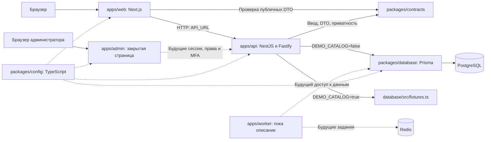

[English](PROJECT_MAP.md) | [Русский](PROJECT_MAP.ru.md)

# Карта проекта

Проверено по исходникам `main` 6 октября 2026 года. Это карта текущей реализации;
будущие модули описаны в [плане](WEB_STACK_PLAN.ru.md).
Страницы и API перечислены в [карте сайта](SITE_MAP.ru.md), таблицы — в [модели данных](DATA_MODEL.ru.md).

## Рабочие папки и Git

| Папка или ref                                                                                         | Что находится                                                                              | Как используется                                                             |
| ----------------------------------------------------------------------------------------------------- | ------------------------------------------------------------------------------------------ | ---------------------------------------------------------------------------- |
| `C:/Users/dogem/Documents/AnimeSoul`, `main`                                                          | Новый веб-проект TypeScript                                                                | Основная разработка и локальный запуск                                       |
| `C:/Users/dogem/Documents/AnimeSoulArchive`, `codex/legacy-local-2026-10-06`                          | Прежняя локальная рабочая папка на старом `master`, включая приватные данные и зависимости | Восстановление локального состояния; не участвует в сборке сайта             |
| `codex/archive-current-2026-10-06`, тег `archive-current-2026-10-06`, коммит `cd54517`                | Зафиксированный снимок прежней реализации                                                  | История и сравнение исходников; секретов в снимке нет                        |
| `C:/Users/dogem/Documents/AnimeSoulMobile`, собственная `main`                                        | Самостоятельный Android-репозиторий                                                        | Собственные сборки, документы и история; новый API пока не подключён         |
| `C:/Users/dogem/.codex/worktrees/new-web-stack/AnimeSoul`, `codex/root-workspace-transfer-2026-10-06` | Дополнительная рабочая копия нового стека                                                  | Больше не занимает `main`; основной запуск перенесён в `Documents/AnimeSoul` |

Пути выше описывают эту локальную машину. Для нового checkout достаточно корня репозитория,
Node.js и pnpm; соседние папки не требуются. Удалённая default branch и production не переключались.
Защищённая копия данных лежит в `AnimeSoulArchive/artifacts/migration-backup/2026-10-06`;
правила восстановления — в [статусе миграции](../migration/STATUS.ru.md).

## Дерево исходников

```text
AnimeSoul/
  apps/
    web/
      app/                   Next.js страницы, layout, ошибки, robots и sitemap
      components/            Шапка сайта, профиль, карточки, иконки и подвал
      lib/                   Серверный HTTP-клиент и правила SEO
      styles/                CSS по страницам; app/globals.css подключает их
      public/                Логотип и доверенные SVG-пресеты профиля
    api/
      src/main.ts            Точка запуска API
      src/app.ts             Nest-модуль, Fastify и общая HTTP-защита
      src/config.ts          Проверка серверной конфигурации
      src/catalog/           Каталог и публичные профили: controller + service
      src/health/            Живость процесса и готовность PostgreSQL
      src/admin/             Закрытая административная граница
      tests/                 Проверки HTTP и конфигурации API
    admin/app/               Отдельный Next.js; пока страница закрытого доступа
    worker/                  Описание будущего worker; исполняемого приложения нет
  packages/
    contracts/src/           Zod-схемы, удаление скрытых полей, политика провайдеров
    contracts/tests/         Приватность и приоритет запрета провайдера
    database/prisma/         Схема БД и версионируемые SQL-миграции
    database/src/            PostgreSQL-клиент, fixtures и локальный seed
    config/                  Общие TypeScript, ESLint и Prettier
  docs/                      Карты, архитектура, запуск, безопасность и миграция
  infra/compose.dev.yaml      Только локальные PostgreSQL и Redis
  scripts/
    workspace/               setup, build, dev и запуск дочерних pnpm-команд
    quality/                 Проверка ссылок документации
    windows/                 Start AnimeSoul.bat
  tests/                     SEO, собранный HTML и интеграция PostgreSQL
  .github/workflows/quality.yml
  package.json               Команды workspace, Node.js и закреплённый pnpm
  pnpm-workspace.yaml         Пакеты workspace и правила установки
  pnpm-lock.yaml              Зафиксированные зависимости
  .env.example               Шаблон локальных настроек без рабочих секретов
  .vscode/settings.json       Путь общего ESLint-конфига для редактора
```

`node_modules`, `.next`, `dist`, Prisma `generated`, `artifacts` и приватный `.env`
создаются локально и игнорируются Git. Пустой остаток старого `app/deploy`, если Windows
удерживает его открытым, не содержит исходников и не используется новым стеком.
Настройки IDE также не являются исходниками.
Конфигурация Prettier обнаруживается через поле `prettier` в `package.json`;
его ignore-файл остаётся в корне. Git, EditorConfig, Docker и pnpm используют свои стандартные корневые файлы.
Утилиты описаны в [scripts/README](../../scripts/README.ru.md), настройки — в [packages/config/README](../../packages/config/README.ru.md).

## Что с чем связано



Сплошные связи работают сейчас. Пунктир между admin/worker и API/Redis показывает будущую интеграцию;
связи `packages/config` действуют при компиляции. Redis запускается compose, но приложение
пока его не использует. Мобильный клиент ещё не потребляет новый API.

`apps/web/lib/api.ts` исполняется только на сервере Next.js. Браузер не получает доступ
к PostgreSQL или `DATABASE_URL`. Серверные страницы получают JSON от API, проверяют его
через `contracts` и формируют HTML. Клиентские `SiteHeader` и `ProfileHeader` отвечают за меню
и анимацию при прокрутке; запросов изменения аккаунта у них нет.

### Пример: публичный профиль

1. Next.js открывает `/users/:username` и запрашивает `/api/profiles/:username`.
2. `CatalogController` проверяет длину имени; `CatalogService` читает fixture либо публичную запись БД.
3. `publicProfile()` удаляет скрытые блоки, внутреннюю видимость и лишние поля; `invisible` становится `offline`.
4. `getProfile()` проверяет публичный DTO. Страница строит видимые блоки и разрешённые metadata/JSON-LD.
5. `ProfileHeader` плавно сворачивает идентичность в шапку. Эта анимация не сохраняет настройки профиля.

Приватность применяется до HTTP-ответа, HTML и метаданных. Оформление `badge` — публичная строка;
оно не является доказательством административной роли или премиум-права.

## Где менять конкретную функцию

| Задача                  | Основные файлы                                                                                 | Связанные проверки и документы                                                              |
| ----------------------- | ---------------------------------------------------------------------------------------------- | ------------------------------------------------------------------------------------------- |
| Главная                 | `apps/web/app/page.tsx`, `styles/home.css`                                                     | [Карта страниц](SITE_MAP.ru.md), `tests/website.test.mjs`                                   |
| Каталог и фильтры       | `apps/web/app/catalog/page.tsx`, `styles/catalog.css`, `apps/api/src/catalog/`                 | `contracts/src/catalog.ts`; фильтры кроме `q` пока применяются страницей                    |
| Страница аниме          | `apps/web/app/anime/[slug]/page.tsx`, `styles/anime.css`                                       | DTO каталога, metadata и `tests/seo.test.mjs`                                               |
| Профиль и его шапка     | `apps/web/app/users/[username]/page.tsx`, `components/ProfileHeader.tsx`, `styles/profile.css` | `contracts/src/profiles.ts`, тесты приватности и HTML                                       |
| Общая навигация         | `components/SiteHeader.tsx`, `components/SiteFooter.tsx`, `styles/header.css`                  | Карта переходов; ссылки на реальные маршруты                                                |
| Публичный API           | `apps/api/src/catalog/`, `apps/web/lib/api.ts`, `packages/contracts/src/`                      | `apps/api/tests/api.test.mjs`; [API](SITE_MAP.ru.md#публичный-api)                          |
| Схема и миграции        | `packages/database/prisma/`, `src/index.ts`                                                    | [Модель данных](DATA_MODEL.ru.md), `tests/database.test.mjs`                                |
| Администрация           | `apps/admin/app/`, `apps/api/src/admin/`, защита в `src/app.ts`                                | Пока запрет 401; сессии/MFA остаются условием переноса                                      |
| Медиа профиля           | `apps/web/public/profile-presets/`                                                             | [Описание assets](../../apps/web/public/ASSETS.ru.md); picker и загрузки ещё не реализованы |
| Запуск и инфраструктура | `scripts/`, `infra/compose.dev.yaml`, `.env.example`                                           | [Локальная разработка](../operations/LOCAL_DEVELOPMENT.ru.md)                               |
| Проверки CI             | `.github/workflows/quality.yml`, корневой `package.json`                                       | Build → types → lint → tests → docs; отдельно format и audit                                |

У текущего API нет каталога `src/modules`, общего пакета `ui`, OpenAPI или генерируемого мобильного SDK.
Это цели плана. При изменении маршрута, DTO, модели или команды обновляются соответствующая карта
и обе языковые версии документа, затем выполняются проверки по [инструкции запуска](../operations/LOCAL_DEVELOPMENT.ru.md).
