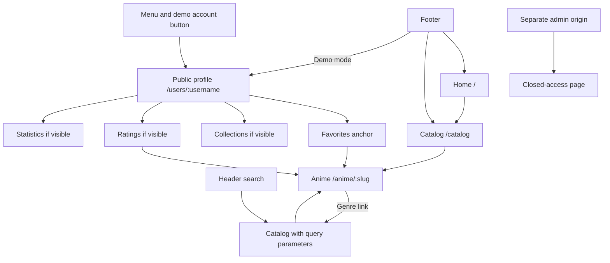

[English](SITE_MAP.md) | [Русский](SITE_MAP.ru.md)

# Site and API map

Implemented `main` routes as of 2026-10-06. Local origins: website `http://localhost:8021`,
API `http://127.0.0.1:8020`, administration `http://localhost:8022`.
The `/api` prefix currently belongs to port 8020; Next.js does not proxy it yet.

## Pages and navigation

| URL                                                | Content/data                                                                                                      | Source under `apps/web/app`                                                   | State                                                                     |
| -------------------------------------------------- | ----------------------------------------------------------------------------------------------------------------- | ----------------------------------------------------------------------------- | ------------------------------------------------------------------------- |
| `/`                                                | Banner, empty watching shelf, up to 6 cards from `GET /api/catalog`                                               | [page.tsx](../../apps/web/app/page.tsx)                                       | SSR works; resume playback is pending                                     |
| `/catalog`                                         | Cards, search and filter form                                                                                     | [catalog/page.tsx](../../apps/web/app/catalog/page.tsx)                       | SSR works; no pagination                                                  |
| `/catalog?q=…&genre=…&status=…&sort=…&from=…&to=…` | Filtered version of the same page                                                                                 | Same source                                                                   | Canonical `/catalog`; nonempty query parameters trigger noindex           |
| `/anime/:slug`                                     | Poster, names, year, genres, status and description from `GET /api/anime/:slug`                                   | [anime/[slug]/page.tsx](../../apps/web/app/anime/%5Bslug%5D/page.tsx)         | SSR/metadata work; playback, episodes and save controls are pending       |
| `/users/:username`                                 | Cover, avatar, username, UUID, decorative badge, presence and permitted blocks from `GET /api/profiles/:username` | [users/[username]/page.tsx](../../apps/web/app/users/%5Busername%5D/page.tsx) | Public read; no owner editing/persistence                                 |
| `/robots.txt`                                      | Crawl rules from `PUBLIC_INDEXING`                                                                                | [robots.ts](../../apps/web/app/robots.ts)                                     | Local crawling is disallowed                                              |
| `/sitemap.xml`                                     | Home, catalog, published anime and eligible public profiles                                                       | [sitemap.ts](../../apps/web/app/sitemap.ts)                                   | Empty locally; requires real data and public HTTPS                        |
| Unknown URL                                        | 404 page                                                                                                          | [not-found.tsx](../../apps/web/app/not-found.tsx)                             | Includes legacy `/account`, `/auth` and `/watch`, absent from the new app |
| Content read failure                               | Page error message                                                                                                | [error.tsx](../../apps/web/app/error.tsx)                                     | API failures do not silently introduce fabricated content                 |

Fixture examples: `/anime/attack-on-titan`, `/anime/frieren`, `/anime/violet-evergarden`,
`/anime/your-name`. `/users/soul` is a fixture, not a signed-in account.
The `soul` header button appears with `DEMO_CATALOG=true`.

### Catalog parameters

| Parameter    | Values/behavior                                                                   |
| ------------ | --------------------------------------------------------------------------------- |
| `q`          | Trimmed title query, at most 100 characters; the only filter forwarded to the API |
| `genre`      | Exact genre from the returned catalog                                             |
| `status`     | `released`, `ongoing`, `announced`                                                |
| `sort`       | `title` by default; `newest` or `oldest` by year                                  |
| `from`, `to` | Four-digit year from 1900 to 2200; invalid input is ignored                       |

The server page applies genre, status, year and sorting to the returned records.
Database mode returns at most 60 title-sorted records: these filters do not yet cover the entire database.
Search also requests the unfiltered catalog for genre options. Full-text/trigram search,
username search, season relationships and pagination remain planned.

### Profile sections

| Anchor                 | Public DTO field | Availability                                                 |
| ---------------------- | ---------------- | ------------------------------------------------------------ |
| `#profile-favorites`   | `favoriteIds`    | Only when favorites are permitted by the server              |
| `#profile-collections` | `folders`        | Only when collections are permitted; no separate folder page |
| `#profile-ratings`     | `ratings`        | Only when ratings are permitted                              |
| `#profile-statistics`  | `statistics`     | Only when statistics are permitted                           |

About appears below the username without a separate route. Anchors are sections of one page,
not sitemap entries. The demo profile exposes about, favorites and statistics; collections/ratings are hidden.
Hidden blocks and their local navigation do not appear in server HTML.
Stored presence values: `online`, `offline`, `dnd`, `invisible`; public `invisible` becomes `offline`.
Owner presence changes and persistent settings are not implemented.
Presence is a stored profile field; heartbeat and automatic online detection are also pending.

## Public API

Routes come from [CatalogController](../../apps/api/src/catalog/catalog.controller.ts);
liveness/readiness from [HealthController](../../apps/api/src/health/health.controller.ts).
Every response has `Cache-Control: no-store`. [app.ts](../../apps/api/src/app.ts) denies the
administrative prefix before handlers execute.

| Method/path                     | Response/constraints                                                                                         | Consumer                                 |
| ------------------------------- | ------------------------------------------------------------------------------------------------------------ | ---------------------------------------- |
| `GET /api/health`               | `status: ok`, version `0.4.0`; checks process, not database                                                  | Diagnostics                              |
| `GET /api/ready`                | 200 if `SELECT 1` succeeds; otherwise 503                                                                    | PostgreSQL readiness                     |
| `GET /api/catalog?q=…`          | `{ source, items }`; query ≤ 100 characters, invalid input 400; database reads published records, maximum 60 | Home, catalog, profile favorites/ratings |
| `GET /api/anime/:slug`          | Public `Anime`; `[a-z0-9-]` slug, length 1–160; missing/invalid slug 404                                     | Anime page/metadata                      |
| `GET /api/profiles/:username`   | Public DTO with hidden fields removed; name > 80 characters or unavailable record 404                        | Profile/metadata                         |
| `GET /api/sitemap/catalog`      | `{ slug, updatedAt }[]`, published non-demo records only; demo returns `[]`                                  | Sitemap                                  |
| `GET /api/sitemap/profiles`     | `{ username, updatedAt }[]`, public indexing-enabled profiles of active users; demo returns `[]`             | Sitemap                                  |
| Any `/api/admin` or nested path | 401; no management operations                                                                                | Future admin app                         |

Database mode fails if persistence is unavailable; it does not silently enable fixtures.
There are no write APIs yet: login/logout, profile/library mutations, media uploads, GIF search,
playback streams and payment callbacks are absent. See the [data model](DATA_MODEL.md) for DTO boundaries.

## Administration

Port 8022 implements `/` and `/robots.txt`. The home page returns 200 explaining closed access,
with no personal/financial data or functional dashboard. Metadata, `X-Robots-Tag` and robots
deny indexing/crawling. This is a separate application, not `/admin` inside the public website.
Administrative sessions and UI-to-API integration are pending.

## Indexing

`PUBLIC_INDEXING=false` means noindex, robots disallow and an empty sitemap.
Enabling it requires `DEMO_CATALOG=false` and a public HTTPS `SITE_URL`.
Anime also requires `indexable`; profiles require owner indexing consent and public availability.
Descriptions/JSON-LD use public DTOs, keeping hidden fields out of search metadata.
Anime uses `CreativeWork`; profile uses `ProfilePage`/`Person`, emitted only when indexing is permitted.

Sitemap excludes filters, anchors, admin, account and development records; update dates come from the database.
The generator rejects totals over 50,000 URLs until sharding is implemented.
Redirect tables, OpenAPI, localization and Search Console integration are pending.
Robots controls crawling, not authorization.

## Planned product routes

These are proposed addresses for later work, not existing pages.

| Area              | Proposed address                                                                        | Prerequisite                                                        |
| ----------------- | --------------------------------------------------------------------------------------- | ------------------------------------------------------------------- |
| Authentication    | `/auth/login`, `/auth/register`, `/auth/reset`                                          | Sessions, passwords, CSRF and anti-bot                              |
| Owner settings    | `/account`, `/account/profile`, `/account/privacy`, `/account/security`                 | Ownership, persistent presence/media/visibility, session revocation |
| Library           | `/library`, `/library/folders/:id`, `/library/history`                                  | Normalized records and imported UUIDs/progress                      |
| Public collection | `/users/:username/collections/:id`                                                      | Folder visibility policy and dedicated DTO                          |
| Playback          | Player on `/anime/:slug`; dedicated watch URL to be decided during migration            | Permitted provider, seasons/episodes, progress and rights           |
| Premium/payment   | `/premium`, `/payment/return`                                                           | Plans, server entitlements, sandbox and verified callbacks          |
| Help/legal        | `/help`, `/terms`, `/privacy`                                                           | Reviewed texts before public launch                                 |
| Management        | Separate admin origin: users, catalog, providers, media, billing, security, system, SEO | Sessions/MFA, permissions, audit and defined metric formulas        |

Update the route map and DTOs alongside new pages, APIs and checks.
See the [migration roadmap](WEB_STACK_PLAN.md) for sequencing.
