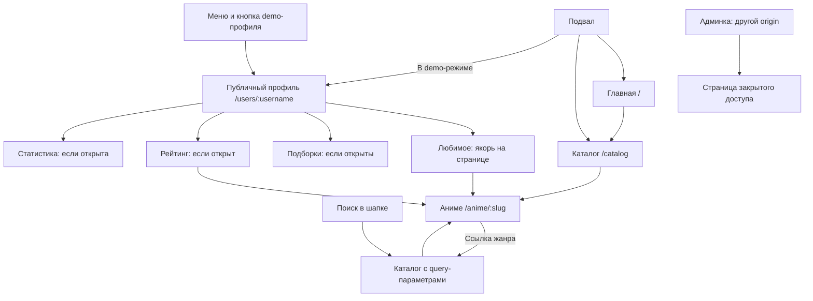

[English](SITE_MAP.md) | [Русский](SITE_MAP.ru.md)

# Карта сайта и API

Текущие маршруты `main`, 6 октября 2026 года. Адрес сайта локально — `http://localhost:8021`,
API — `http://127.0.0.1:8020`, отдельная админка — `http://localhost:8022`.
Корень API `/api` сейчас принадлежит порту 8020: проксирования через Next.js ещё нет.

## Страницы и переходы

| URL                                                | Содержание и данные                                                                                             | Исходник в `apps/web/app`                                                     | Состояние                                                                     |
| -------------------------------------------------- | --------------------------------------------------------------------------------------------------------------- | ----------------------------------------------------------------------------- | ----------------------------------------------------------------------------- |
| `/`                                                | Баннер, пустое «Смотрю сейчас», до 6 карточек из `GET /api/catalog`                                             | [page.tsx](../../apps/web/app/page.tsx)                                       | SSR работает; продолжение просмотра ещё не подключено                         |
| `/catalog`                                         | Карточки, поиск и форма фильтров                                                                                | [catalog/page.tsx](../../apps/web/app/catalog/page.tsx)                       | SSR работает; пагинации нет                                                   |
| `/catalog?q=…&genre=…&status=…&sort=…&from=…&to=…` | Та же страница с фильтрами                                                                                      | Тот же файл                                                                   | Canonical `/catalog`, при непустых параметрах noindex                         |
| `/anime/:slug`                                     | Постер, названия, год, жанры, статус и описание из `GET /api/anime/:slug`                                       | [anime/[slug]/page.tsx](../../apps/web/app/anime/%5Bslug%5D/page.tsx)         | SSR и metadata работают; плеера, серий и кнопок сохранения ещё нет            |
| `/users/:username`                                 | Шапка, аватар, ник, UUID, декоративный статус, присутствие и разрешённые блоки из `GET /api/profiles/:username` | [users/[username]/page.tsx](../../apps/web/app/users/%5Busername%5D/page.tsx) | Публичное чтение; владелец ещё не может редактировать/сохранять               |
| `/robots.txt`                                      | Разрешения обхода по `PUBLIC_INDEXING`                                                                          | [robots.ts](../../apps/web/app/robots.ts)                                     | Локально запрещён весь обход                                                  |
| `/sitemap.xml`                                     | Главная, каталог, опубликованные аниме и разрешённые публичные профили                                          | [sitemap.ts](../../apps/web/app/sitemap.ts)                                   | Локально пустой; требует реальных данных и публичного HTTPS                   |
| Неизвестный URL                                    | Страница 404                                                                                                    | [not-found.tsx](../../apps/web/app/not-found.tsx)                             | Включая старые `/account`, `/auth` и `/watch`, которых в новом приложении нет |
| Ошибка чтения контента                             | Сообщение об ошибке страницы                                                                                    | [error.tsx](../../apps/web/app/error.tsx)                                     | Ошибка API не подменяется выдуманным контентом                                |

В demo-каталоге есть `/anime/attack-on-titan`, `/anime/frieren`, `/anime/violet-evergarden`
и `/anime/your-name`. `/users/soul` — fixture, а не вошедший пользователь.
Кнопка `soul` в шапке показывается при `DEMO_CATALOG=true`.

### Фильтры каталога

| Параметр     | Значения и поведение                                                          |
| ------------ | ----------------------------------------------------------------------------- |
| `q`          | Название; trim и максимум 100 символов. Единственный фильтр, передаваемый API |
| `genre`      | Точное значение из жанров полученного каталога                                |
| `status`     | `released`, `ongoing`, `announced`                                            |
| `sort`       | `title` по умолчанию; `newest` или `oldest` по году                           |
| `from`, `to` | Четырёхзначный год от 1900 до 2200; некорректное значение игнорируется        |

Жанр, статус, годы и сортировка применяются серверной страницей к уже полученным записям.
В режиме БД API возвращает максимум 60 записей по названию: это ещё не фильтрация всего каталога.
При поиске страница дополнительно читает каталог без `q` для вариантов жанров.
Full-text/trigram, поиск пользователей, связи сезонов и пагинация остаются в плане.

### Разделы профиля

| Якорь                  | Поле публичного DTO | Видимость                                                               |
| ---------------------- | ------------------- | ----------------------------------------------------------------------- |
| `#profile-favorites`   | `favoriteIds`       | Только если сервер разрешил любимое                                     |
| `#profile-collections` | `folders`           | Только если сервер разрешил подборки; отдельной страницы папки пока нет |
| `#profile-ratings`     | `ratings`           | Только если сервер разрешил оценки                                      |
| `#profile-statistics`  | `statistics`        | Только если сервер разрешил статистику                                  |

«Обо мне» находится под ником и не имеет отдельного маршрута. Якоря — части одной страницы,
а не дополнительные URL sitemap. У demo-профиля открыты «обо мне», любимое и статистика;
подборки и оценки скрыты. Скрытые блоки и их локальная навигация отсутствуют в серверном HTML.
Статусы хранения: `online`, `offline`, `dnd`, `invisible`; публичный `invisible` выдаётся как `offline`.
Постоянное изменение присутствия и настроек владельцем ещё не реализовано.
Это сохранённое поле профиля; heartbeat и автоматическое определение онлайна пока отсутствуют.

## Публичный API

Источник маршрутов — [CatalogController](../../apps/api/src/catalog/catalog.controller.ts),
живость/готовность — [HealthController](../../apps/api/src/health/health.controller.ts).
Все ответы имеют `Cache-Control: no-store`; защищённый административный префикс проверяется
в [app.ts](../../apps/api/src/app.ts) до выполнения обработчиков.

| Метод и путь                        | Ответ / ограничения                                                                                            | Кто использует                             |
| ----------------------------------- | -------------------------------------------------------------------------------------------------------------- | ------------------------------------------ |
| `GET /api/health`                   | `status: ok`, версия `0.4.0`; проверяет процесс, не БД                                                         | Локальная диагностика                      |
| `GET /api/ready`                    | 200, если `SELECT 1` прошёл; иначе 503                                                                         | Проверка PostgreSQL                        |
| `GET /api/catalog?q=…`              | `{ source, items }`; `q` ≤ 100 символов, неправильный ввод 400; в БД только опубликованные записи, максимум 60 | Главная, каталог, любимое и оценки профиля |
| `GET /api/anime/:slug`              | Публичный `Anime`; slug `[a-z0-9-]`, длина 1–160; отсутствие/невалидный slug 404                               | Страница аниме и её metadata               |
| `GET /api/profiles/:username`       | Публичный DTO после удаления скрытых полей; имя > 80 символов или недоступная запись 404                       | Профиль и metadata                         |
| `GET /api/sitemap/catalog`          | `{ slug, updatedAt }[]`, только опубликованные не-demo записи; в demo `[]`                                     | Генератор sitemap                          |
| `GET /api/sitemap/profiles`         | `{ username, updatedAt }[]`, только публичные индексируемые профили активных пользователей; в demo `[]`        | Генератор sitemap                          |
| Любой `/api/admin` и вложенный путь | 401; никаких операций управления пока нет                                                                      | Будущая админка                            |

Без доступной БД чтение в `DEMO_CATALOG=false` завершается ошибкой; фиктивный каталог автоматически
не включается. Записей через API пока нет: отсутствуют login/logout, изменения профиля/библиотеки,
загрузка медиа, GIF-поиск, получение потоков и платёжные callbacks.
Контракты данных описаны в [модели](DATA_MODEL.ru.md).

## Админка

На порту 8022 реализованы `/` и `/robots.txt`. `/` возвращает 200 с объяснением закрытого доступа,
без пользовательских/финансовых данных и без рабочего dashboard. Metadata и `X-Robots-Tag`
запрещают индексацию; robots запрещает обход. Это отдельное приложение, а не `/admin` внутри сайта.
Административной сессии и подключения этого UI к API пока нет.

## Индексация

`PUBLIC_INDEXING=false` означает noindex, запрет robots и пустой sitemap.
Включение требует `DEMO_CATALOG=false` и публичного HTTPS `SITE_URL`.
Аниме дополнительно требует `indexable`; профиль — разрешение владельца `indexable` и публичную доступность.
Публичный DTO используется также для description/JSON-LD: скрытые поля не уходят в поисковые метаданные.
JSON-LD аниме — `CreativeWork`; JSON-LD профиля — `ProfilePage` с `Person` и выдаётся только при разрешённой индексации.

Sitemap не содержит фильтров, якорей, admin, кабинета и demo-записей; даты взяты из БД.
При сумме более 50 000 URL генератор требует разделения sitemap на файлы.
Redirect-таблицы, OpenAPI, локализация и подключение Search Console пока не реализованы.
Robots — инструкция поисковику, а не защита закрытых данных.

## Планируемая карта продукта

Это предложения адресов для следующих этапов, а не существующие страницы.

| Раздел                          | Предлагаемый адрес                                                                                               | Что необходимо перед реализацией                                         |
| ------------------------------- | ---------------------------------------------------------------------------------------------------------------- | ------------------------------------------------------------------------ |
| Вход/регистрация/восстановление | `/auth/login`, `/auth/register`, `/auth/reset`                                                                   | Серверные сессии, пароли, CSRF и антибот                                 |
| Настройки владельца             | `/account`, `/account/profile`, `/account/privacy`, `/account/security`                                          | Проверка владельца, сохранение присутствия/медиа/видимости, отзыв сессий |
| Библиотека                      | `/library`, `/library/folders/:id`, `/library/history`                                                           | Нормализованные записи и перенос UUID/прогресса                          |
| Подборка пользователя           | `/users/:username/collections/:id`                                                                               | Правила публичности папки и отдельный DTO                                |
| Просмотр                        | Страница `/anime/:slug` с плеером; отдельный URL просмотра определить при переносе                               | Допустимый источник, сезоны/серии, прогресс и права                      |
| Премиум/оплата                  | `/premium`, `/payment/return`                                                                                    | Тарифы, серверные права, sandbox и проверенные callbacks                 |
| Помощь и условия                | `/help`, `/terms`, `/privacy`                                                                                    | Готовые тексты перед публичным запуском                                  |
| Управление                      | Разделы на отдельном admin origin: пользователи, каталог, провайдеры, медиа, платежи, безопасность, система, SEO | Сессии/MFA, права, аудит и определённые формулы метрик                   |

Для реализации новых маршрутов сначала обновляется эта карта и DTO, затем страницы, API и проверки.
Порядок этапов — в [плане миграции](WEB_STACK_PLAN.ru.md).
